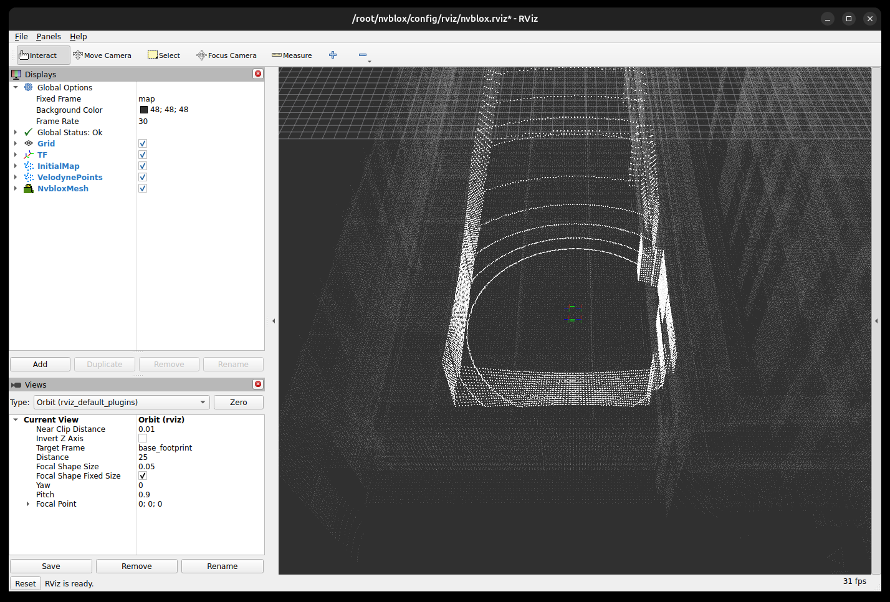
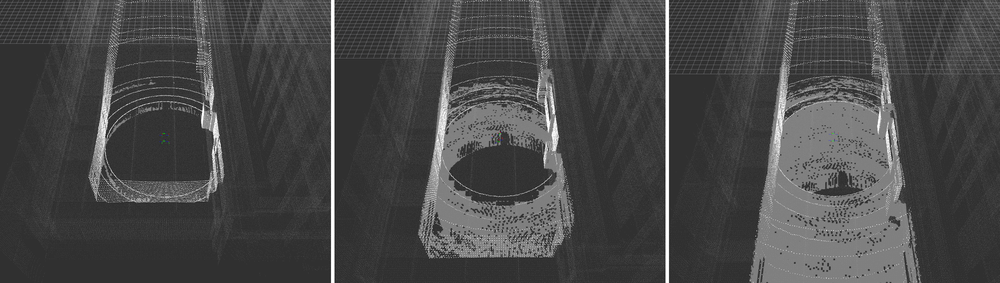
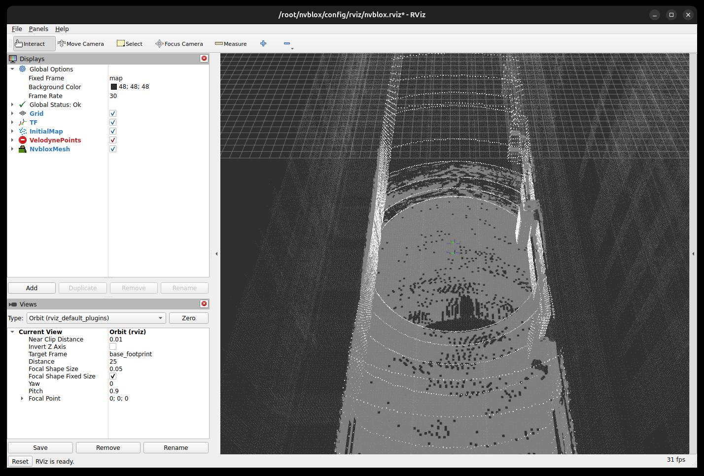
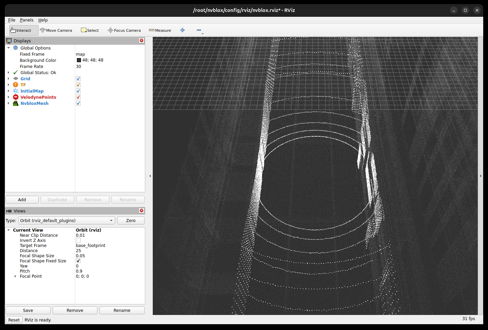
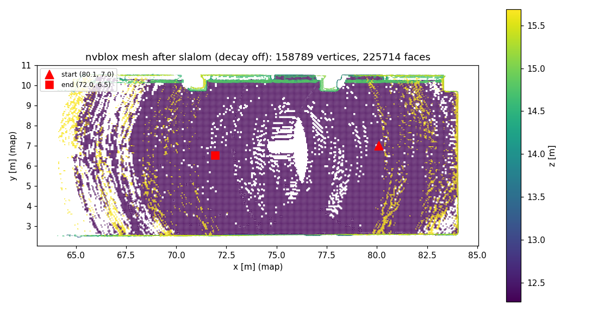
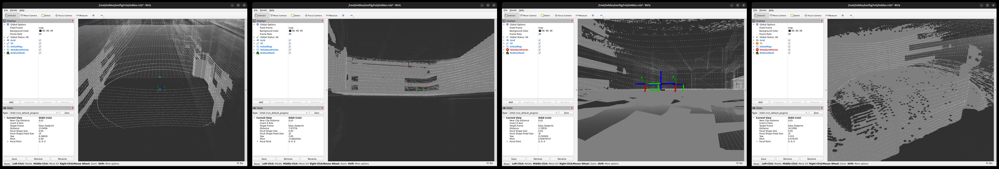

# 開発ログ（nvblox）

作業したら日付・項目ごとに末尾へ追記する。各項目は目的・やったこと・結果（数値）・図。図は `dev_log_images/` に置く。

## 2026-11-17

### 1. GPU の確認と Isaac ROS の版の決定

- 目的：nvblox を動かす Isaac ROS の版を GPU で決める。
- やったこと：ホストで `nvidia-smi --query-gpu=name,compute_cap,driver_version,memory.total --format=csv`。
- 結果：
  - `NVIDIA GeForce RTX 5080, 12.0, 595.99.02, 16303 MiB`、CUDA Version 13.2。
  - compute capability 12.0（Blackwell）は Isaac ROS 3.2（Ubuntu 22.04・Humble・CUDA 12.6）が対応しない。
  - ユーザーと相談して **Isaac ROS 4.6**（4.x の最新。Ubuntu 24.04・ROS 2 Jazzy・CUDA 13.2 以上・ドライバ 595 以上・Ampere 以降）にした。
    Humble の他のコンテナ（Gazebo `20261002`・`test`・`octomap`）とは DDS で通信する（つながるかは項目 2）。
  - apt リポジトリは版を固定する `release-4.6`。ベースは `nvidia/cuda:13.2.1-runtime-ubuntu24.04`（ドライバ 595.99 が扱えるのは CUDA 13.2 まで）。
  - `.bashrc` の通信設定は localization の写しを Jazzy に直した（非推奨の `ROS_LOCALHOST_ONLY` をやめ、`ROS_AUTOMATIC_DISCOVERY_RANGE=SUBNET`。
    127.0.0.1 に限るのは今までどおり `fastdds_localhost.xml`）。

### 2. イメージのビルド

- 目的：自前の Dockerfile で Isaac ROS 4.6 の nvblox を入れる。
- やったこと・結果：
  - 1 回目は apt の依存で失敗：
    - `libnvvpi4`・`vpi4-dev`（VPI）が無い → Isaac ROS 4.6 の文書の x86 の手順どおり、Jetson の apt リポジトリ
      （`https://repo.download.nvidia.com/jetson/x86_64/noble r39.2 main`）を足した。
    - ベースのイメージが `libcublas-13-2` を 13.4.0.1 で固定（apt-mark hold）していて、`cuda-libraries-13-2` が求める 13.4.1.3 以上にできない
      → `apt-mark unhold libcublas-13-2`。runtime のままで足りた（devel にしても同じく固定されている）。
  - 2 回目で成功。入った版は `ros-jazzy-isaac-ros-nvblox 4.6.0`（`nvblox_ros`・`nvblox_msgs`・`nvblox_rviz_plugin` など）。イメージは 29 GB。
  - `ros2 pkg executables nvblox_ros` に `nvblox_node` があるので、launch は実行ファイルで起動する（コンポーネントにはしない）。
  - nvblox_rviz_plugin の表示は `nvblox_rviz_plugin/NvbloxMesh`（`NvbloxVoxelBlockLayer` もある）。
- パラメータ：nvblox_node を単体で起動して `ros2 param dump`・`describe` で全項目と既定値を確かめ、`param/gazebo/params.yaml` に全部書いた。
  launch で起動した後の `ros2 param dump` は yaml の全項目と一致した（yaml に無いのは読み取り専用の `qos_overrides.*` だけ）。
  - 既定で `base_link` を指すのは `pose_frame`・`map_clearing_frame_id`・`esdf_slice_bounds_visualization_attachment_frame_id`・
    `workspace_height_bounds_visualization_attachment_frame_id`・`ground_plane_visualization_attachment_frame_id` の 5 つ → `base_footprint`。
  - Gazebo の VLP-16（`wheelchair_2.xacro`：16 本・上下 ±15°・水平 `samples="440"`・10 Hz・`organize_cloud` false）に合わせ、
    `lidar_width` を 1800 → 440。`lidar_height` 16・`lidar_vertical_fov_rad` 0.5236 は既定のまま合っている。
  - 4.6 には `use_lidar_motion_compensation`（既定 true）・`pointcloud2_timestamps_are_relative`（既定 true）がある。
    Gazebo の点群の `time` は全点 0.0 なので、補正は実質かからない（既定のままにしたが、起動すると落ちたので項目 3 で false にした）。
  - 起動のたびに `Requested weighting function: "kInverseSquareWeight" not recognized. Defaulting to: kInverseSquareWeight`・
    `workspace bounds type: "kUnbounded" not recognized` の WARN が出る。yaml を渡さず既定値で起動しても同じなので、nvblox 側の表示の癖（動作は既定どおり）。

### 3. 段階 1 の確認（GPU・描画・Humble との通信・DDS）と、起動して分かったこと

- 目的：コンテナで GPU と描画が使えること、Humble の Gazebo・`test` と Jazzy の nvblox が通信できること、DDS が 127.0.0.1 だけであることを確かめる。
- やったこと：Gazebo（`connection_wheelchair.launch.py`）→ `test` の推定（`env:=gazebo rviz:=false map_path:=/root/ros2_ws/map/SC10_4_0.05.pcd`）を起動し、
  nvblox のコンテナから受信した。nvblox は `ros2 launch /root/nvblox/config/nvblox.launch.py env:=gazebo rviz:=true`。
- 結果：
  - `nvidia-smi`：`NVIDIA GeForce RTX 5080, 595.99.02`。`glxinfo -B`：renderer `NVIDIA GeForce RTX 5080/PCIe/SSE2`（OpenGL 4.6.0 NVIDIA 595.99.02、direct rendering）。
  - **Humble ↔ Jazzy**：`/velodyne_points`・`/tf`・`/tf_static`（transient_local）・`/clock` が見え、どれも受信できた。`tf2_echo map velodyne` も引ける。
    点群は 7040 点（440 × 16）、`height` 1（organize されていない）、frame `velodyne`。
    `ros2 topic info -v` で Humble 側のノードは `_NODE_NAME_UNKNOWN_`・型のハッシュ `INVALID` と出る（Humble は Jazzy の型のハッシュを持たない。通信には影響しない）。
  - **QoS**：`/velodyne_points` の配信は RELIABLE・VOLATILE。`input_qos: SYSTEM_DEFAULT` の nvblox_node の購読は BEST_EFFORT・VOLATILE（互換）。`input_qos` は既定のまま。
  - **DDS は 127.0.0.1 の UDP だけ**：`nvblox_node`・`rviz2` のソケット（`/proc/<pid>/fd` の inode を `/proc/<pid>/net/{udp,udp6,tcp,tcp6}` と突き合わせた）は
    各 4 つで全部 `127.0.0.1`、TCP なし。ホストの `/proc/net/igmp` で 239.255.0.1 にはどのインタフェース（lo・enp129s0・docker0）も参加していない。
  - **nvblox_node が起動直後に落ちた**：`Check failed: maybe_scan_duration_ms.value() > Time(0)`（`pointcloud_to_depth_conversion_impl.cuh:176`）。
    Gazebo の点群の点ごとの `time` が全部 0.0 で、歪みの補正（`use_lidar_motion_compensation`、既定 true）がスキャンの長さを 0 と見るため。
    → `use_lidar_motion_compensation: false`。以後は落ちない。
  - **メッシュが RViz に出ない**（下図。点群と地図だけ）：`/nvblox_node/mesh` は 4.6 Hz で届くが、ブロックの頂点が全部空。
    診断の表示（`print_rates`・`print_timings` など）で、点群は 10.3 Hz で積み上がり、深度画像（`/nvblox_node/lidar_image`）も 7024 / 7040 画素が有効だった。
    原因は**表示の除外**：`layer_visualization_exclusion_height_m`（既定 2.0。「z がこれより上のボクセルは表示しない」）で、Gazebo の地図は床が map の z ≈ 12.3 m なので全部除かれる。
    一時的に値を変えて起動し、10〜12 s 受けたメッシュで比べた（止まったまま、ロボットは (80.1, 7.0)）：

    | `layer_visualization_exclusion_height_m` / `_radius_m` | 頂点のあるブロック | ロボットからの最大の水平距離 |
    |---|---|---|
    | 2.0 / 5.0（既定） | 0 | — |
    | 100 / 5.0 | 229 | 5.0 m |
    | 100 / 100 | 347 | 9.2 m |
    | -1 / -1 | 349 | 9.2 m |

    半径（`layer_visualization_exclusion_radius_m`、既定 5.0。「ロボットからこれより遠いボクセルは表示しない」）も表示を 5 m に限る（9.2 m は点群を積み上げる上限 10 m による）。
    負の値でどちらも無効になる。どうするかはユーザーに確認する。
  - 既定のままの `decay_tsdf_rate_hz` 5 Hz で「Last view not set for sensor type. Decaying all voxels」の INFO が 0.2 s ごとに出る（static_tsdf でも TSDF を減衰させている。
    影響は段階 2 の走行で見る）。

### 4. 表示の除外を無効にする（ユーザー確認済み）

- `layer_visualization_exclusion_height_m`・`layer_visualization_exclusion_radius_m` を -1（無効）にした（項目 3 の表）。
  `use_lidar_motion_compensation: false`（項目 3）もユーザーに確認した。

### 5. 段階 2：テスト走行（Gazebo、slalom、案 A）

- 目的：走行中にメッシュが積み上がり、ロボットから離れた所も残ることを確かめる。GPU メモリを記録する。
- やったこと：
  - `drive`（localization_tools の `run_test.sh`）は Gazebo では**推定を自分で起動する**（推定が動いていると「localization processes are still running」で止まる）。
    起動の順（Gazebo → test → nvblox）を保つため：Gazebo を起動 → `test` の中で `drive gazebo slalom check/nvblox_slalom map_path:=/root/ros2_ws/map/SC10_4_0.05.pcd`
    （`docker exec -d`）→ 「start recording and localization」が出て 8 s 後に nvblox（`rviz:=true`）→ 走り出す（推定の起動から 25 s 後）。
  - 走行中、1 s ごとに `nvidia-smi --query-compute-apps` で nvblox_node の GPU メモリを取り、RViz の窓を `import -window` で撮った。
- 結果：
  - 走行：forward 1.10 s・1.01 m、slalom 12.47 s・7.52 m。録画は localization の `docker/data/bags/gazebo/check/nvblox_slalom`（42.9 s、75.3 MB）。
    走り終えると `drive` が推定を止める。
  - **メッシュは走行に沿って積み上がる**（下図。左から走る前・走行中・走行後 5 s。灰色がメッシュ、白は今の点群）。床と壁が 0.05 m のボクセルで埋まる。
  - **nvblox_node の GPU メモリ**：起動後 1302 MiB → 走行の開始 1366 MiB → 走行の終わり 1818 MiB（走行中 1 s ごとに 1366・1430・1462・1558・1590・1622・1654・1686・1786・1818 MiB）。
    GPU の全体 16303 MiB。
  - **nvblox_node のログ**：TF 待ち・入力の取りこぼしの警告は出なかった（起動時の「Lookup transform failed for frame base_footprint」が 1 回だけ。推定が TF を出す前）。
    「Last view not set for sensor type. Decaying all voxels」の INFO が 5 Hz で出続ける（約 300 s で 1509 回）。
  - **走行後、地図が消えた**：走行後 5 s の RViz にはメッシュがあったが、約 2 分後には RViz からも消え（下の 2 枚目）、`~/mesh` を新しく購読して
    地図全体を受け直しても頂点のあるブロックは 0。RViz は削除（空のブロック）を受け取るまでブロックを持ち続けるので、nvblox が地図を消したと考えられる。
    static_tsdf でも TSDF の減衰（`decay_tsdf_rate_hz` 5 Hz、`tsdf_decay_factor` 0.95、`tsdf_decayed_weight_threshold` 0.001 で
    ブロックを解放）がかかり、LiDAR では「最後の視野」（減衰から除く範囲）が設定されないので全部のボクセルが減衰する、と読める。
    重みの上限 5 から 0.001 までは 0.95 を 166 回（5 Hz で約 33 s）。見えなくなった所は数十秒で消える計算で、完了条件「離れた所も消えずに残る」を満たさない。
    （推定が止まると TF が無くなり点群を積めないので、走行後は全部が「見えない所」になる。）
  - `drive` のログに「sequence size exceeds remaining buffer」（Fast DDS がメッセージを読めないときの表示）が 2 回出た。これまでの drive のログには無い。
    Jazzy のノードが加わったためかもしれないが、原因は調べていない。走行と録画は正常に終わった。

RViz の画面全体（走行後 5 s）と、約 2 分後（メッシュが消えた）：

## 2026-11-18

### 6. 段階 2：減衰を止めて走り直し、メッシュを保存する（ユーザー指示）

- 目的：TSDF の減衰（項目 5）を止め、離れた所が走行後も残ることを確かめる。できたメッシュをファイルに保存する。
- やったこと：
  - `param/gazebo/params.yaml` の `decay_tsdf_rate_hz` を 5.0 → **0.0**（減衰しない）。`static_mapper.tsdf_decay_factor: 1.0` は nvblox_node が落ちるので使わない（項目 5）。
  - Gazebo を起動し直して車椅子を初期位置に戻し、項目 5 と同じ順で `drive gazebo slalom check/nvblox_slalom_nodecay map_path:=/root/ros2_ws/map/SC10_4_0.05.pcd`。
  - 走行後に nvblox_node のサービス `~/save_ply`（`nvblox_msgs/srv/FilePath`）でメッシュを PLY（ascii）に保存した：
    `ros2 service call /nvblox_node/save_ply nvblox_msgs/srv/FilePath "{file_path: '/tmp/<名前>.ply'}"`。走行後 5 s と 2 分後に 1 回ずつ。
- 結果：
  - 走行：forward 1.09 s・1.00 m、slalom 12.47 s・7.52 m。録画は `check/nvblox_slalom_nodecay`（43.9 s、72.7 MiB）。
  - **減衰は止まった**：「Decaying all voxels」は 0 回。nvblox_node の WARN は起動時の 2 種（項目 2 と同じ、無害）だけで、TF 待ち・取りこぼしは無し。
  - **離れた所も残る**：保存したメッシュは走行後 5 s・2 分後とも **頂点 158,789・面 225,714**（数は同じ）。範囲は x 64.1〜84.1 m・y 2.4〜10.6 m・z 12.3〜15.7 m。
    到着位置 (72.0, 6.5) から最大 12.7 m、10 m より遠い頂点が 21.9 %。出発位置の後ろの壁（x ≈ 84、到着から約 12 m）も残っている（下の図）。
    RViz でも 2 分後にメッシュが残っている（下の帯の右端）。
  - **nvblox_node の GPU メモリ**：走り出す時点 1270 MiB → 最大 1498 MiB → 走行の終わり 1434 MiB。2 分待って `save_ply` を 2 回呼んだ後は 1882 MiB。
  - メッシュのファイル：`maps/nvblox_slalom_nodecay.ply`（14.9 MB。`.gitignore` の `*.ply` で git には入れない）。
    コンテナには `config/` しか割り当てていないので、`/tmp` に保存して `docker cp` でホストに移した。
  - 項目 5 の訂正：`~/mesh` を新しく購読しても、nvblox は更新されたブロックしか送らないので、地図があっても 0 ブロックになる（今回、メッシュが残っているのに 0 だった）。
    項目 5 で地図が消えた根拠は、RViz から消えたことと減衰のログの方になる。
  - `drive` のログの「sequence size exceeds remaining buffer」は今回も 2 回出た（原因は調べていない）。

